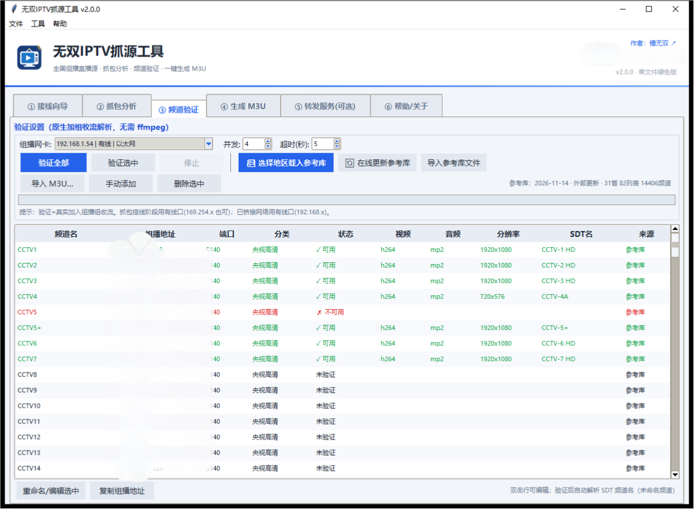
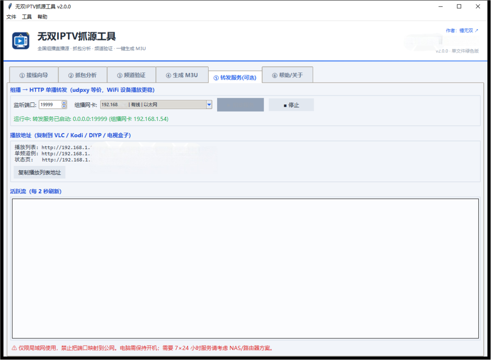

# 无双IPTV

> **作者：B站-锤无双** · **QQ群：170621740** · [📺 视频教程](https://www.bilibili.com/video/BV17SWk6VEPZ/) · [作者主页](https://www.bilibili.com/video/BV17SWk6VEPZ/)

让家里机顶盒退役：抓取 / 验证自家 IPTV 组播直播源，一键生成 M3U 播放列表，全家电视、手机、平板都能看直播。
Windows **单文件绿色版**，双击即用，无需安装任何驱动 / 运行库。
**v2.1 新增 CLI 命令行模式**（可被 AI 工具直接调用）与 **4K 高 DPI 字体自适应**，详见 [更新说明](CHANGELOG.md)。

> ### 🧪 跨平台测试版（v2.1.0-beta）
> **Linux / macOS / 鸿蒙PC 版均为测试版：未做真机测试，仅供参考。**
> Windows 版保持 v2.1.0 正式版不变。详见 [跨平台说明](docs/跨平台说明.md) 与 [鸿蒙版说明](harmony/README.md)。


## ✨ 功能

- **接线向导**：回答几个硬件问题，自动生成插拔网线步骤 + 拓扑图。支持三种场景：
  - 傻瓜交换机搭线（老路由）
  - **路由器 IPTV 口 / VLAN 绑定（免交换机）**
  - 已桥接合并网络（机顶盒退役）
  - ⚠ 移动「四口盲插」（能上网能看电视但抓不到）属特殊情况：见[专项方案](docs/山东移动盲插抓包方案.md) / [一页纸接线](docs/山东移动盲插_一页纸接线.md)
- **抓包分析**：用 Windows 内置 `pktmon`（无需 Wireshark/Npcap），机顶盒换台自动发现组播地址，自动去重、过滤噪声。
- **频道验证**：原生加组收流解析 MPEG-TS（PAT/PMT/SDT/SPS），**不依赖 ffmpeg**，自动命名、标出编码 / 分辨率 / 可用性。
- **全国参考库**：覆盖 31 省 × 电信/联通/移动/广电，按省份+运营商载入；支持在线更新 / 离线导入。
- **生成 M3U**：`udp://` 组播直连 + `http://` udpxy 转发双格式，指定目录保存 / 合并 / 自动更新。
- **一键推送 NAS**：SMB 共享 / WebDAV，抓完自动同步播放列表到 NAS，配合 Tvheadend/udpxy 实现 7×24 转发。
- **转发服务**：内置 udpxy 等价服务，组播转 HTTP 单播，WiFi 设备播放更稳。
- **CLI 命令行模式（v2.1）**：`WushuangIPTV-CLI.exe` 无界面跑通全流程，JSON 输出 + 退出码，**可被 AI 工具（Claude Code / DSH / Cursor 等）直接调用**；仅抓包需要管理员。
- **4K 高 DPI 自适应（v2.1）**：按系统真实 DPI 缩放字体与界面，高分屏不再字小；1080p 下观感不变。

## 📷 截图

| | |
|---|---|
|  |  |
|  |  |

## 🚀 快速开始

1. 下载 [Releases](../../releases) 里的 `WushuangIPTV.exe`（无双IPTV抓源工具，单文件绿色版；或自行[构建](#-构建)），双击运行（自动请求管理员权限）。
2. ① 接线向导选你的场景 → 照步骤接线。
3. ② 抓包分析：开始抓包 → 机顶盒逐个换台（每台停 3~5 秒）→ 停止并分析 → 加入频道列表。
   （已桥接 / 免交换机场景可跳过抓包，直接 ③ 载入参考库。）
4. ③ 频道验证：选组播网卡 → 验证全部。
5. ④ 生成 M3U：选输出目录 → 保存；可选「一键推送到 NAS」。
6. 用 VLC / Kodi / DIYP / [无双电视 APK](#-配套-apk) 打开播放列表即可。

详细图文见 [docs/使用说明.md](docs/使用说明.md)，视频见 [B站教程](https://www.bilibili.com/video/BV17SWk6VEPZ/)。

## 🤖 AI 工具 / 命令行调用（v2.1）

下载 Releases 里的 `WushuangIPTV-CLI.exe`（控制台版，不强制管理员），AI 工具或脚本即可直接操作：

```bash
WushuangIPTV-CLI.exe info                                          # 环境总览（网卡/参考库/建议网卡）
WushuangIPTV-CLI.exe verify --province 浙江 --carrier 电信 --out verified.json  # 载入参考库并实测验证
WushuangIPTV-CLI.exe m3u --channels verified.json --outdir D:\iptv            # 生成 udp+http 双版 M3U
```

- stdout 单个 JSON 结果、stderr JSONL 进度、退出码 0成功/1失败/2参数错误/3需管理员；
- 频道 JSON 贯穿 load→verify→m3u→proxy/push；仅 `capture` 抓包需要管理员；
- 首次运行若弹 Windows 防火墙提示请点「允许访问」。

完整命令参考：[docs/CLI使用说明.md](docs/CLI使用说明.md) · AI 工具入口：[AGENTS.md](AGENTS.md)

## 💻 跨平台版本（Linux / macOS / 鸿蒙PC）

> ⚠️ **三个新平台均为 v2.1 测试版：未做真机测试，仅供参考。** 真实 IPTV 环境验证前请勿用于生产。
> Linux 已在 WSL（Ubuntu 22.04）完成功能验证（自测 48 项 + 组播回环端到端 + 真实 tcpdump 抓包 + 打包运行）；
> macOS 与 Linux 共用 POSIX 代码路径，由 CI 构建覆盖；鸿蒙版已构建出 HAP，待签名与真机验证。

| 平台 | 版本 | 抓包 | 验证/M3U/转发 | 获取方式 |
|---|---|---|---|---|
| Windows 10 1809+ / 11 | **v2.1.0 正式** | ✅ pktmon（管理员） | ✅ | [Releases](../../releases) exe |
| Linux x64 | v2.1.0-beta | ✅ tcpdump（sudo） | ✅ | CI 产物 / 源码 / `build_cli.sh` |
| macOS Intel / Apple Silicon | v2.1.0-beta | ✅ tcpdump（sudo，系统自带） | ✅ | CI 产物 / 源码 / `build_cli.sh` |
| 鸿蒙PC（HarmonyOS NEXT，2in1） | v2.1.0-beta | ❌ 系统无第三方抓包权限 | ✅ 精简版 | DevEco 打开 `harmony/` 签名运行 |

### Linux / macOS 快速开始

```bash
# 源码方式（Python 3.10+，核心零第三方依赖）
sudo apt install python3 python3-tk tcpdump        # Linux；macOS 自带 tcpdump，Python 用 python.org 版
python3 src/main.py cli info                       # 环境总览
python3 src/main.py cli verify --province 浙江 --carrier 电信 --out verified.json
python3 src/main.py cli m3u --channels verified.json --outdir ./out
python3 src/main.py                                # 图形界面（tkinter）
sudo ./WushuangIPTV-CLI capture --seconds 90       # 二进制版抓包需 sudo，其余命令免 root

# 构建单文件二进制（PyInstaller，不能跨平台交叉编译）
pip install pyinstaller
bash src/build_cli.sh && bash src/build.sh         # 产物在 dist/
```

- CLI 协议与 Windows 完全一致（JSON 输出/退出码），`version` 显示 `2.1.0-beta` 并附 `beta_note` 声明；
- NAS 推送：挂载目录或 `smb://` URL（smbclient）；WebDAV 不变；
- macOS 未签名产物首次打开需**右键 → 打开**；WSL2 默认 NAT 收不到物理局域网组播（需镜像网络模式或真机）；
- 完整差异与注意事项：**[docs/跨平台说明.md](docs/跨平台说明.md)**。

### 鸿蒙PC 精简版（harmony/）

- ArkTS/ArkUI 原生工程（DevEco Studio 6 / API 22）：参考库载入（**应用内在线更新**）、
  `MulticastSocket` 组播实测验证、M3U 生成导出、`TCPSocketServer` HTTP 转发；
- **不含抓包**（鸿蒙第三方应用无原始抓包权限，系统限制）；
- 运行：DevEco Studio 打开 `harmony/` → 登录华为账号自动签名 → 模拟器/真机；
  命令行构建 `harmony/build_hap.bat`（产物未签名）；
- 模拟器只能验证 UI/参考库/M3U，**真实收流需鸿蒙PC真机 + 有线接入 IPTV 网络**；
- 完整说明：**[harmony/README.md](harmony/README.md)**。

### CI 自动构建

推送 `v*` 标签或手动触发 [GitHub Actions](.github/workflows/build.yml)：
linux-x64 / macos-x64 / macos-arm64 / windows-x64 四平台自测 + 构建，产物在 Actions Artifacts。

## 📱 配套 APK

| 文件 | 说明 |
|---|---|
| [apk/WushuangTV.apk](apk/WushuangTV.apk) | 无双电视 · 电视版（约1.6M，安卓4.0+ 老电视可用，遥控器/数字选台/收藏） |
| [apk/WushuangTV-Phone.apk](apk/WushuangTV-Phone.apk) | 无双电视 · 手机版（触屏、横屏全屏） |

填入生成的播放列表地址即可观看。

## 🔧 构建

需要 Python 3.10+、PyInstaller、Pillow（仅生成图标用）。

```powershell
cd src
pip install pyinstaller pillow
.\build.ps1        # Windows GUI 版，产物在 ..\dist\无双IPTV抓源工具.exe
.\build_cli.ps1    # Windows CLI 版（v2.1），产物在 ..\dist\WushuangIPTV-CLI.exe
```

```bash
# Linux / macOS（测试版）
bash src/build_cli.sh   # CLI，产物 dist/WushuangIPTV-CLI
bash src/build.sh       # GUI，产物 dist/WushuangIPTV-GUI（macOS 为 .app）
```

- 默认**不内嵌**全国参考库（见下），首次运行点「在线更新参考库」即可拉取。
- 如需内嵌：先 `python fetch_national.py` 抓取社区数据到 `ref/national`，再 `python build_refdb.py`，然后构建脚本会自动打包 `refdb.json.gz`（CI 用 `python src/ci_refdb.py` 一步完成）。
- 自测：`python selftest.py`（48 项，合成数据，无需真实网络）；Linux/macOS 另有 `python3 e2e_posix.py` 回环端到端冒烟。

## 📚 参考库数据说明

全国组播参考数据来自社区开源仓库 [xisohi/CHINA-IPTV](https://github.com/xisohi/CHINA-IPTV)（每日更新）。
出于**许可证与隐私**考虑，本仓库**不直接捆绑**该数据；工具在运行时按需下载（仅在你点击更新时联网），或可离线导入 `refdb.json`。
参考库只是候选地址，各地运营商会调整，**一切以本机实测验证为准**。

## ⚖️ 法律与隐私声明

- 本工具仅供**个人学习、研究，在自家局域网内自用**。接收的是你已付费订阅的 IPTV 服务内容。
- **请勿**将抓取的源公开分享、售卖、搭建公网服务供他人观看，或用于任何商业/非法目的；否则可能侵犯著作权/广播组织权并承担法律责任。
- 请勿克隆机顶盒账号获取未付费业务。
- 软件不后台联网、不上传任何数据；不收集任何个人信息。
- 转发服务仅限局域网，禁止映射公网。

## 📝 更新历史

见 [CHANGELOG.md](CHANGELOG.md)（Windows v2.1.0：CLI 命令行模式 + 4K 高 DPI 修复；Linux/macOS/鸿蒙 v2.1.0-beta 测试版：跨平台移植，未做真机测试，仅供参考）。

## 📄 License

[MIT](LICENSE) © 锤无双 (chuiziyao)
