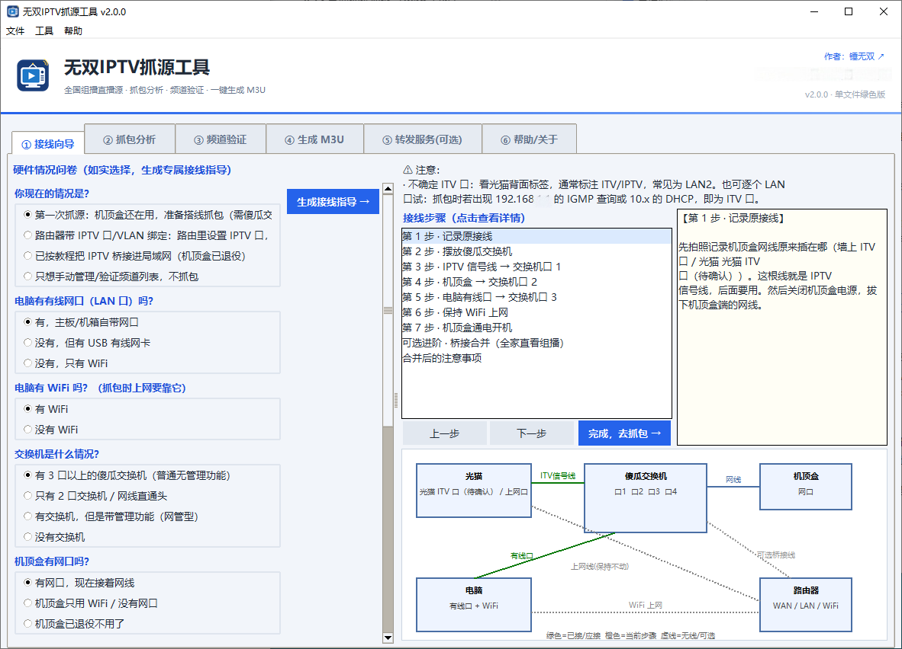
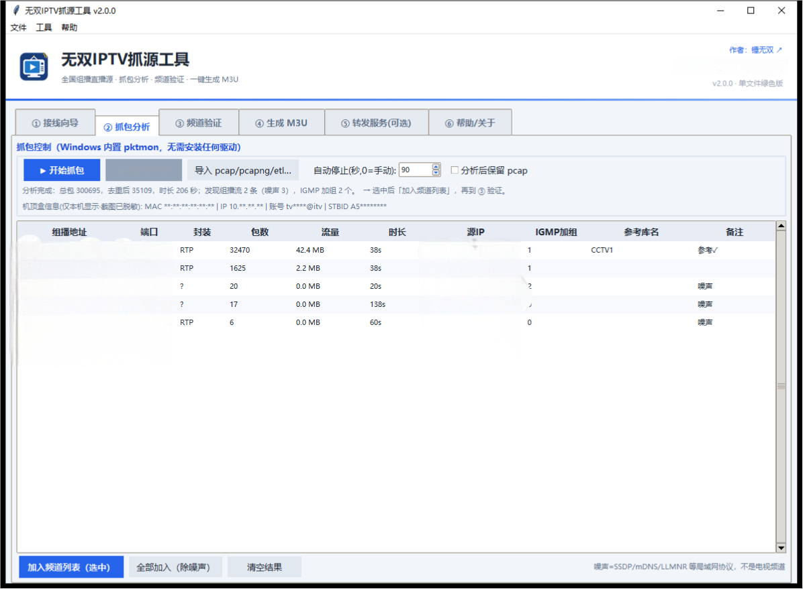
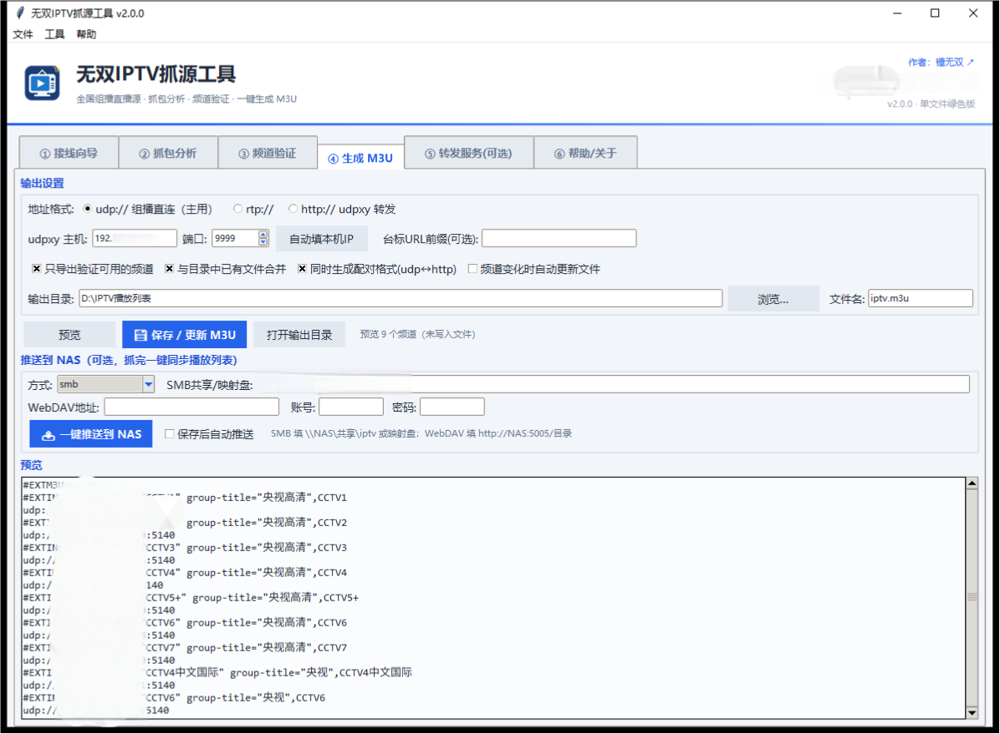

# 无双IPTV

> **作者：B站-锤无双** · **QQ群：170621740** · [📺 视频教程](https://www.bilibili.com/video/BV17SWk6VEPZ/) · [作者主页](https://www.bilibili.com/video/BV1hTxx69EFY/)

让家里机顶盒退役：抓取 / 验证自家 IPTV 组播直播源，一键生成 M3U 播放列表，全家电视、手机、平板都能看直播。
Windows **单文件绿色版**，双击即用，无需安装任何驱动 / 运行库。



## ✨ 功能

- **接线向导**：回答几个硬件问题，自动生成插拔网线步骤 + 拓扑图。支持三种场景：
  - 傻瓜交换机搭线（老路由）
  - **路由器 IPTV 口 / VLAN 绑定（免交换机）**
  - 已桥接合并网络（机顶盒退役）
- **抓包分析**：用 Windows 内置 `pktmon`（无需 Wireshark/Npcap），机顶盒换台自动发现组播地址，自动去重、过滤噪声。
- **频道验证**：原生加组收流解析 MPEG-TS（PAT/PMT/SDT/SPS），**不依赖 ffmpeg**，自动命名、标出编码 / 分辨率 / 可用性。
- **全国参考库**：覆盖 31 省 × 电信/联通/移动/广电，按省份+运营商载入；支持在线更新 / 离线导入。
- **生成 M3U**：`udp://` 组播直连 + `http://` udpxy 转发双格式，指定目录保存 / 合并 / 自动更新。
- **一键推送 NAS**：SMB 共享 / WebDAV，抓完自动同步播放列表到 NAS，配合 Tvheadend/udpxy 实现 7×24 转发。
- **转发服务**：内置 udpxy 等价服务，组播转 HTTP 单播，WiFi 设备播放更稳。

## 📷 截图

| | |
|---|---|
|  |  |
|  |  |

## 🚀 快速开始

1. 下载 [Releases](../../releases) 里的 `无双IPTV抓源工具.exe`（或自行[构建](#-构建)），双击运行（自动请求管理员权限）。
2. ① 接线向导选你的场景 → 照步骤接线。
3. ② 抓包分析：开始抓包 → 机顶盒逐个换台（每台停 3~5 秒）→ 停止并分析 → 加入频道列表。
   （已桥接 / 免交换机场景可跳过抓包，直接 ③ 载入参考库。）
4. ③ 频道验证：选组播网卡 → 验证全部。
5. ④ 生成 M3U：选输出目录 → 保存；可选「一键推送到 NAS」。
6. 用 VLC / Kodi / DIYP / [无双电视 APK](#-配套-apk) 打开播放列表即可。

详细图文见 [docs/使用说明.md](docs/使用说明.md)，视频见 [B站教程](https://www.bilibili.com/video/BV17SWk6VEPZ/)。

## 📱 配套 APK

| 文件 | 说明 |
|---|---|
| [apk/WushuangTV.apk](apk/WushuangTV.apk) | 无双电视 · 电视版（约1.6M，安卓4.0+ 老电视可用，遥控器/数字选台/收藏） |
| [apk/WushuangTV-Phone.apk](apk/WushuangTV-Phone.apk) | 无双电视 · 手机版（触屏、横屏全屏） |

填入生成的播放列表地址即可观看。

## 🔧 构建

需要 Python 3.10+、PyInstaller、Pillow（仅生成图标用）。

```powershell
cd src
pip install pyinstaller pillow
.\build.ps1        # 产物在 ..\dist\无双IPTV抓源工具.exe
```

- 默认**不内嵌**全国参考库（见下），首次运行点「在线更新参考库」即可拉取。
- 如需内嵌：先 `python fetch_national.py` 抓取社区数据到 `ref/national`，再 `python build_refdb.py`，然后 `build.ps1` 会自动打包 `refdb.json.gz`。
- 自测：`python selftest.py`（合成数据，无需真实网络）。

## 📚 参考库数据说明

全国组播参考数据来自社区开源仓库 [xisohi/CHINA-IPTV](https://github.com/xisohi/CHINA-IPTV)（每日更新）。
出于**许可证与隐私**考虑，本仓库**不直接捆绑**该数据；工具在运行时按需下载（仅在你点击更新时联网），或可离线导入 `refdb.json`。
参考库只是候选地址，各地运营商会调整，**一切以本机实测验证为准**。

## ⚖️ 法律与隐私声明

- 本工具仅供**个人学习、研究，在自家局域网内自用**。接收的是你已付费订阅的 IPTV 服务内容。
- **请勿**将抓取的源公开分享、售卖、搭建公网服务供他人观看，或用于任何商业/非法目的；否则可能侵犯著作权/广播组织权并承担法律责任。
- 请勿克隆机顶盒账号获取未付费业务。
- 软件不后台联网、不上传任何数据；不收集任何个人信息。
- 转发服务仅限局域网，禁止映射公网。

## 📄 License

[MIT](LICENSE) © 锤无双 (chuiziyao)
